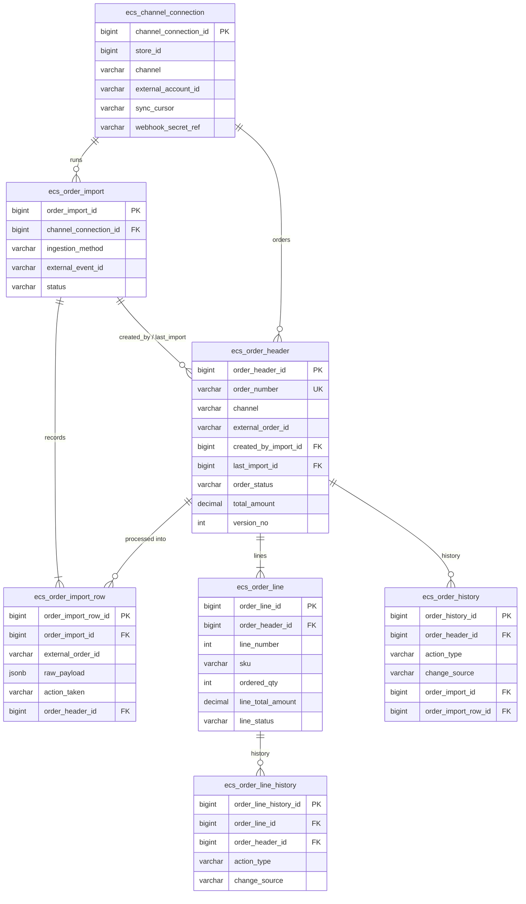

# Order Management & Import – ERD

Oct 17, 2026 · @priyam

Implemented in `backend/app/models/orders.py` and migration
`backend/alembic/versions/10753ffcecb4_order_management_and_import_tables.py` (#6).
See [Implementation notes](#implementation-notes) for the choices the ERD left open.

## Overview

Seven tables store every order and record exactly how it reached us. Four hold the order itself, two record each import run and its records, and one holds each store's marketplace connection.

Orders arrive through four ingestion methods. Every method creates an `ecs_order_import` run, so all four are tracked the same way.

| Ingestion method | Triggered by | Channel | What it creates |
| --- | --- | --- | --- |
| `csv_upload` | Customer uploads a CSV in the UI | `csv` | 1 import run, 1 import row per CSV line |
| `scheduled_sync` | Background scheduler, every N minutes | Shopify, Amazon, other marketplaces | 1 import run per pull, 1 import row per order fetched |
| `manual_sync` | Customer clicks Sync now in the UI | Shopify, Amazon, other marketplaces | Same as a scheduled sync, with the user recorded |
| `webhook` | Marketplace pushes an order event | Shopify, Amazon, other marketplaces | 1 import run per delivery, 1 import row |

| Table | Group | Holds |
| --- | --- | --- |
| `ecs_channel_connection` | Configuration | One record per connected marketplace account: sync schedule, sync cursor, webhook setup |
| `ecs_order_import` | Ingestion | One record per import run: CSV upload, sync or webhook delivery |
| `ecs_order_import_row` | Ingestion | One record per order record received in a run, with the raw payload |
| `ecs_order_header` | Order | The complete order: customer, addresses, totals, payment, status |
| `ecs_order_line` | Order | Each item with its quantity, price, tax, payment share and shipping |
| `ecs_order_history` | Audit | Every change to an order header |
| `ecs_order_line_history` | Audit | Every change to an order line |

`ecs_channel_connection` is new in this design. Scheduled syncs need somewhere to keep the cursor they resume from, and webhooks need their configuration and signing secret stored.

## Entity relationship diagram

The import side feeds the order header; the header owns its lines, and each has its own history. Both history tables also point back to the import run and import row that caused each change, which is not drawn here to keep the picture readable.

## How order provenance is recorded

Provenance is stored as two separate values: **channel** says *where* the order came from, and **ingestion method** says *how* we received it. A Shopify order can arrive by scheduled sync, manual sync or webhook, so one column cannot answer both questions.

| Question | Answered by |
| --- | --- |
| Which marketplace or file did the order come from? | `ecs_order_header.channel`, `channel_connection_id` |
| How did we first receive it? | `ecs_order_header.ingestion_method`, `created_by_import_id` |
| How did the latest update arrive, and when? | `ecs_order_header.last_ingestion_method`, `last_import_id`, `last_synced_at` |
| What exactly did the marketplace or file send? | `ecs_order_import_row.raw_payload` |
| Who triggered it? | `ecs_order_import.triggered_by_user_id` (null for scheduled syncs and webhooks) |
| Which webhook event delivered it? | `ecs_order_import.external_event_id`, `event_topic` |
| How did each individual change arrive? | `ecs_order_history.change_source`, `order_import_id`, `order_import_row_id` (same on the line history) |

Changes made inside our own system, such as an admin editing an address, have no import run. Their history record has `change_source = admin_ui`, `customer` or `system`, and the import columns stay null.

## Table definitions

Money columns use DECIMAL(12,2), never FLOAT. Every table also has `created_at` and `updated_at` unless stated otherwise.

### ecs\_channel\_connection

One record per marketplace account a store has connected. CSV uploads need no connection.

| Column | Type | Key | Description |
| --- | --- | --- | --- |
| `channel_connection_id` | BIGINT | PK |  |
| `store_id` | BIGINT | FK | Store or tenant that owns the connection |
| `channel` | VARCHAR(30) |  | `shopify`, `amazon`, `flipkart`, `woocommerce` |
| `connection_name` | VARCHAR(100) |  | Label shown in the UI, e.g. "Main Shopify store" |
| `external_account_id` | VARCHAR(150) |  | Shop domain or seller ID on the marketplace |
| `marketplace_region` | VARCHAR(30) |  | Marketplace or region ID, where the channel has several |
| `credential_ref` | VARCHAR(255) |  | Pointer to the token in a secrets vault; tokens are never stored in this table |
| `connection_status` | VARCHAR(20) |  | `active`, `auth_expired`, `disconnected`, `error` |
| `sync_enabled` | BOOLEAN |  | Scheduled pulls on or off |
| `sync_interval_minutes` | INT |  | How often the scheduled sync runs |
| `sync_cursor` | VARCHAR(500) |  | Where the next pull resumes: last `updated_at` seen or a next-page token |
| `last_synced_at` | TIMESTAMP |  | End of the last successful sync |
| `last_sync_status` | VARCHAR(20) |  | Outcome of the last sync, for the UI |
| `webhook_enabled` | BOOLEAN |  | Whether webhooks are registered |
| `webhook_secret_ref` | VARCHAR(255) |  | Pointer to the secret used to verify webhook signatures |
| `webhook_topics` | JSON |  | Subscribed events, e.g. `orders/create`, `orders/updated` |
| `created_by` | BIGINT |  | User who connected the account |

### ecs\_order\_import

One record per import run, whatever its ingestion method.

| Column | Type | Key | Description |
| --- | --- | --- | --- |
| `order_import_id` | BIGINT | PK |  |
| `store_id` | BIGINT | FK |  |
| `channel_connection_id` | BIGINT | FK, nullable | Null for CSV uploads |
| `channel` | VARCHAR(30) |  | `csv`, `shopify`, `amazon`, … |
| `ingestion_method` | VARCHAR(20) |  | `csv_upload`, `scheduled_sync`, `manual_sync`, `webhook` |
| `triggered_by_user_id` | BIGINT | FK, nullable | User for CSV uploads and manual syncs; null for scheduled syncs and webhooks |
| `external_event_id` | VARCHAR(150) | nullable | Webhook delivery ID from the marketplace, used to ignore repeat deliveries |
| `event_topic` | VARCHAR(50) | nullable | Webhook event type, e.g. `orders/updated` |
| `file_name` | VARCHAR(255) | nullable | CSV only |
| `file_path` | VARCHAR(500) | nullable | Where the uploaded file is stored |
| `file_hash` | CHAR(64) | nullable | SHA-256 of the file, to detect repeat uploads |
| `sync_from`, `sync_to` | TIMESTAMP | nullable | Time window a sync asked the marketplace for |
| `cursor_start`, `cursor_end` | VARCHAR(500) | nullable | Cursor before and after this run |
| `status` | VARCHAR(25) |  | `pending`, `validating`, `processing`, `completed`, `partially_completed`, `failed`, `cancelled` |
| `total_records` | INT |  | Records received |
| `processed_records` | INT |  | Progress counter for the UI |
| `created_count`, `updated_count`, `unchanged_count`, `skipped_count`, `failed_count` | INT |  | Outcome counters |
| `error_summary` | TEXT |  | Run-level failure, e.g. bad CSV header or marketplace API error |
| `started_at`, `completed_at` | TIMESTAMP |  |  |

### ecs\_order\_import\_row

One record per order record received in a run: a CSV line, an order in an API response, or a webhook payload.

| Column | Type | Key | Description |
| --- | --- | --- | --- |
| `order_import_row_id` | BIGINT | PK |  |
| `order_import_id` | BIGINT | FK | Parent run |
| `record_number` | INT |  | CSV line number, or position in the API response |
| `external_order_id` | VARCHAR(100) |  | Order ID in the source; groups multi-line CSV orders |
| `external_line_id` | VARCHAR(100) | nullable | Line ID in the source, where it has one |
| `external_updated_at` | TIMESTAMP | nullable | Marketplace's last-modified time for the order |
| `raw_payload` | JSON |  | Record exactly as received |
| `payload_hash` | CHAR(64) |  | Detects a record identical to what we already stored |
| `status` | VARCHAR(20) |  | `pending`, `valid`, `invalid`, `processed`, `failed` |
| `action_taken` | VARCHAR(20) |  | `created`, `updated`, `unchanged`, `skipped_duplicate`, `skipped_stale`, `failed` |
| `error_messages` | JSON |  | Validation errors, e.g. unknown SKU |
| `order_header_id` | BIGINT | FK, nullable | Order created or updated from this record |
| `processed_at` | TIMESTAMP |  |  |

This table has no `updated_at`; a record is written once and then processed.

### ecs\_order\_header

One record per order. The provenance columns are listed first.

| Column | Type | Key | Description |
| --- | --- | --- | --- |
| `order_header_id` | BIGINT | PK |  |
| `order_number` | VARCHAR(30) | Unique | Customer-facing number |
| `store_id` | BIGINT | FK |  |
| `channel` | VARCHAR(30) |  | Where the order came from: `csv`, `shopify`, `amazon`, `website`, … |
| `channel_connection_id` | BIGINT | FK, nullable | Marketplace account; null for CSV and website orders |
| `external_order_id` | VARCHAR(100) | nullable | Order ID in the source system |
| `ingestion_method` | VARCHAR(20) |  | How the order was first received |
| `created_by_import_id` | BIGINT | FK, nullable | Import run that created the order |
| `last_import_id` | BIGINT | FK, nullable | Import run that last updated it |
| `last_ingestion_method` | VARCHAR(20) | nullable | How the latest update arrived |
| `external_updated_at` | TIMESTAMP | nullable | Source's last-modified time we have applied; older updates are skipped |
| `last_synced_at` | TIMESTAMP | nullable | When we last applied data from the source |
| `order_date` | TIMESTAMP |  | When the customer placed the order |
| `customer_id`, `customer_name`, `customer_email`, `customer_phone` |  |  | Customer link and snapshot |
| `ship_name`, `ship_phone`, `ship_address_line1`, `ship_address_line2`, `ship_landmark`, `ship_city`, `ship_state`, `ship_state_code`, `ship_pincode`, `ship_country` | VARCHAR |  | Shipping address snapshot |
| `bill_*` (same set), `bill_gstin`, `bill_same_as_ship` | VARCHAR, BOOLEAN |  | Billing address snapshot |
| `order_status`, `payment_status`, `fulfillment_status` | VARCHAR(20) |  | Three independent statuses |
| `currency`, `subtotal_amount`, `discount_amount`, `coupon_code`, `shipping_amount`, `tax_amount`, `total_amount`, `paid_amount`, `refunded_amount` | CHAR(3), DECIMAL |  | Totals, equal to the sum of the lines |
| `payment_method`, `payment_gateway`, `payment_reference`, `paid_at` | VARCHAR, TIMESTAMP |  | Order-level payment |
| `customer_notes`, `internal_notes`, `cancel_reason`, `cancelled_at` | TEXT, TIMESTAMP |  |  |
| `version_no` | INT |  | Increases on every change; links to history |
| `is_deleted` | BOOLEAN |  | Soft delete |
| `created_by`, `updated_by` | BIGINT |  | Null when an import made the change |

### ecs\_order\_line

One record per item in an order, with its payment share and shipping.

| Column | Type | Key | Description |
| --- | --- | --- | --- |
| `order_line_id` | BIGINT | PK |  |
| `order_header_id` | BIGINT | FK | Parent order |
| `line_number` | INT |  | 1, 2, 3… within the order |
| `external_line_id` | VARCHAR(100) | nullable | Line ID in the source; matches lines on later updates |
| `product_id`, `variant_id` | BIGINT | FK, nullable | Catalog links; null when an imported SKU is not in the catalog |
| `sku`, `product_name`, `variant_name`, `hsn_code` | VARCHAR |  | Product snapshot |
| `ordered_qty`, `shipped_qty`, `cancelled_qty`, `returned_qty` | INT |  | Supports partial actions |
| `unit_price`, `line_discount_amount`, `tax_rate`, `cgst_amount`, `sgst_amount`, `igst_amount`, `line_total_amount` | DECIMAL |  | Pricing and GST |
| `line_paid_amount`, `line_refunded_amount`, `refund_reference`, `refunded_at` | DECIMAL, VARCHAR, TIMESTAMP |  | This line's share of payment and refunds |
| `warehouse_id`, `courier_name`, `tracking_number`, `shipping_charge`, `shipped_at`, `expected_delivery_date`, `delivered_at` |  |  | Shipping for this line |
| `line_status` | VARCHAR(20) |  | `pending`, `allocated`, `packed`, `shipped`, `delivered`, `cancelled`, `return_requested`, `returned` |
| `version_no` | INT |  |  |
| `created_by`, `updated_by` | BIGINT |  |  |

### ecs\_order\_history

One record per change to an order header. Records are only inserted, never updated.

| Column | Type | Key | Description |
| --- | --- | --- | --- |
| `order_history_id` | BIGINT | PK |  |
| `order_header_id` | BIGINT | FK |  |
| `version_no` | INT |  | Header version after the change |
| `action_type` | VARCHAR(30) |  | `created`, `status_change`, `address_update`, `payment_update`, `cancelled`, `synced_update` |
| `old_status`, `new_status` | VARCHAR(20) |  |  |
| `changed_fields` | JSON |  | Old and new value of each changed column |
| `change_source` | VARCHAR(20) |  | `csv_upload`, `scheduled_sync`, `manual_sync`, `webhook`, `admin_ui`, `customer`, `system` |
| `order_import_id` | BIGINT | FK, nullable | Import run that caused the change |
| `order_import_row_id` | BIGINT | FK, nullable | Exact record that caused the change |
| `changed_by` | BIGINT | nullable | User, when a person made the change |
| `remarks` | TEXT |  |  |
| `changed_at` | TIMESTAMP |  | Replaces `created_at`; no `updated_at` |

### ecs\_order\_line\_history

One record per change to an order line, with the same columns as `ecs_order_history` plus:

| Column | Type | Key | Description |
| --- | --- | --- | --- |
| `order_line_history_id` | BIGINT | PK | Replaces `order_history_id` |
| `order_line_id` | BIGINT | FK | Line that changed |
| `order_header_id` | BIGINT | FK | Copied so an order's line changes need no join |

Its `action_type` values are `created`, `status_change`, `qty_change`, `shipped`, `cancelled`, `returned`, `refunded`.

## Relationships

Every relationship is one-to-many. An order can be touched by many import records over its life (created by a sync, then updated by webhooks), so the link from import records to orders is many-to-one.

| Parent | Child | Cardinality | Foreign key on child | Optional? |
| --- | --- | --- | --- | --- |
| `ecs_channel_connection` | `ecs_order_import` | 1 : N | `channel_connection_id` | Yes, null for CSV |
| `ecs_channel_connection` | `ecs_order_header` | 1 : N | `channel_connection_id` | Yes, null for CSV and website orders |
| `ecs_order_import` | `ecs_order_import_row` | 1 : N | `order_import_id` | No |
| `ecs_order_import` | `ecs_order_header` | 1 : N | `created_by_import_id`, `last_import_id` | Yes |
| `ecs_order_header` | `ecs_order_import_row` | 1 : N | `order_header_id` | Yes, null until processed or if the record failed |
| `ecs_order_header` | `ecs_order_line` | 1 : N | `order_header_id` | No |
| `ecs_order_header` | `ecs_order_history` | 1 : N | `order_header_id` | No |
| `ecs_order_line` | `ecs_order_line_history` | 1 : N | `order_line_id` | No |
| `ecs_order_import` | `ecs_order_history`, `ecs_order_line_history` | 1 : N | `order_import_id` | Yes, null for changes made in our UI |
| `ecs_order_import_row` | `ecs_order_history`, `ecs_order_line_history` | 1 : N | `order_import_row_id` | Yes |

## Data flow by ingestion method

All four methods end in the same processing step, so CSV, sync and webhook orders are validated and saved by one shared code path.

### Shared processing step (every method)

1. For each `ecs_order_import_row`, look up `ecs_order_header` by `(store_id, channel, external_order_id)`.
2. Not found → validate and create the header and lines. Set `ingestion_method`, `created_by_import_id` and `last_import_id`. Write a `created` history record. `action_taken = created`.
3. Found, `payload_hash` matches the last record we are consistent with (the newest `created`, `updated` or `unchanged` row for that order) → `action_taken = unchanged`. Checked before staleness, so re-importing identical data reports `unchanged`.
4. Found, but the record's `external_updated_at` is older than or equal to the header's → `action_taken = skipped_stale`, no change.
5. Found and newer → update the changed columns, increase `version_no`, set `last_import_id`, `last_ingestion_method`, `external_updated_at` and `last_synced_at`, and write history with `change_source` and the import IDs. `action_taken = updated`.
6. Fill `order_header_id` on the import row and update the run's counters.

### CSV upload

1. User uploads a file. Create `ecs_order_import` with `ingestion_method = csv_upload`, `channel = csv`, `triggered_by_user_id`, file name, path and hash. Warn if `file_hash` matches an earlier upload.
2. A background job parses the file into one `ecs_order_import_row` per line, with `record_number` = the line number.
3. Rows are grouped by `external_order_id`, so a multi-item order becomes one header with several lines.
4. Validation errors go into `error_messages`; valid groups go through the shared processing step.
5. The user sees the summary and can download the failed rows.

### Scheduled sync

1. The scheduler finds connections where `sync_enabled = true` and the interval has passed.
2. Create `ecs_order_import` with `ingestion_method = scheduled_sync`, `triggered_by_user_id = null`, and `cursor_start` from the connection's `sync_cursor`.
3. Fetch orders changed since the cursor, page by page; each order becomes one import row with its `raw_payload` and `external_updated_at`.
4. Run the shared processing step.
5. Only when the run succeeds: save `cursor_end` on the run and copy it to `ecs_channel_connection.sync_cursor`, along with `last_synced_at` and `last_sync_status`.

### Manual sync

Same as the scheduled sync, with `ingestion_method = manual_sync` and `triggered_by_user_id` set to the user who clicked Sync now. If a sync is already running for that connection, the UI shows that run instead of starting a second one.

### Webhook

1. The marketplace calls our endpoint. Verify the signature using the connection's `webhook_secret_ref`; reject it if invalid.
2. If an `ecs_order_import` already has this `external_event_id`, return success and stop: it is a repeat delivery.
3. Create `ecs_order_import` with `ingestion_method = webhook`, `event_topic`, and one `ecs_order_import_row` holding the payload. Respond to the marketplace immediately.
4. A background worker runs the shared processing step. Webhooks can arrive out of order, so the `external_updated_at` check in step 3 of the shared step stops an older event from overwriting newer data.

## Indexes, constraints and allowed values

The two unique constraints marked as duplicate protection are what stop the same order or webhook from being saved twice, even if application code has a bug.

| Table | Columns | Type | Purpose |
| --- | --- | --- | --- |
| `ecs_order_header` | `(store_id, channel, external_order_id)` | Unique | Duplicate protection for orders |
| `ecs_order_header` | `order_number` | Unique | Lookup by order number |
| `ecs_order_header` | `(store_id, order_status, order_date)` | Index | Order list with filters |
| `ecs_order_header` | `customer_phone` | Index | Support search |
| `ecs_order_line` | `(order_header_id, line_number)` | Unique | Line order within an order |
| `ecs_order_line` | `tracking_number`, `sku` | Index | Shipment and product lookups |
| `ecs_order_import` | `(channel_connection_id, external_event_id)` | Unique | Duplicate protection for webhooks |
| `ecs_order_import` | `(store_id, created_at)` | Index | Import history screen |
| `ecs_order_import` | `(channel_connection_id, status)` | Index | Check for a running sync before starting another |
| `ecs_order_import` | `file_hash` | Index | Repeat-upload warning |
| `ecs_order_import_row` | `(order_import_id, status)` | Index | Failed records of a run |
| `ecs_order_import_row` | `(external_order_id)` | Index | All records received for one order |
| `ecs_channel_connection` | `(store_id, channel, external_account_id)` | Unique | One connection per marketplace account |
| `ecs_order_history` | `(order_header_id, changed_at)` | Index | Order timeline |
| `ecs_order_line_history` | `(order_line_id, changed_at)` | Index | Line timeline |

| Column | Allowed values |
| --- | --- |
| `channel` | `csv`, `website`, `shopify`, `amazon`, `flipkart`, `woocommerce` (extend as channels are added) |
| `ingestion_method` | `csv_upload`, `scheduled_sync`, `manual_sync`, `webhook`, `direct` (orders placed in our own UI or website) |
| `change_source` | `csv_upload`, `scheduled_sync`, `manual_sync`, `webhook`, `admin_ui`, `customer`, `system` |
| `ecs_order_import.status` | `pending`, `validating`, `processing`, `completed`, `partially_completed`, `failed`, `cancelled` |
| `ecs_order_import_row.action_taken` | `created`, `updated`, `unchanged`, `skipped_duplicate`, `skipped_stale`, `failed` |
| `connection_status` | `active`, `auth_expired`, `disconnected`, `error` |

## Design rules

These rules keep the seven tables consistent when CSV uploads, syncs and webhooks touch the same orders.

- **One transaction per order.** Updating the header and lines, increasing `version_no`, writing history and filling the import row's `order_header_id` happen together or not at all.
- **Newer data wins.** Apply a marketplace record only if its `external_updated_at` is newer than the header's. This handles webhooks that arrive out of order and syncs that re-fetch an order a webhook already delivered.
- **One sync at a time per connection.** Before starting a scheduled or manual sync, check for a run in `pending` or `processing` for that connection. Use a row lock or advisory lock so two workers cannot start one together.
- **Advance the cursor only after success.** If a sync fails halfway, `sync_cursor` stays where it was and the next run re-fetches; the duplicate protection makes that safe.
- **Webhooks are recorded fast and processed later.** Store the event and respond within the marketplace's timeout, then process in the background. Keep scheduled syncs running even when webhooks are enabled, to catch any deliveries that were missed.
- **Header values are calculated from lines.** `order_status`, `fulfillment_status` and all header amounts are recalculated whenever a line changes.
- **Secrets stay out of these tables.** Access tokens and webhook secrets live in a secrets vault; the connection stores only a reference to them.
- **Plan for raw payload growth.** `raw_payload` grows fast with frequent syncs and webhooks. Move or purge payloads older than a set period, such as 90 days, while keeping the import records and counters.

## Implementation notes

Choices made where the ERD left details open (PostgreSQL 18):

- **Not-yet-existing parents.** `store_id`, `customer_id`, `product_id`, `variant_id`, `warehouse_id` and the user columns (`created_by`, `updated_by`, `changed_by`, `triggered_by_user_id`) are plain `BIGINT` with no foreign key yet. The constraints are added in the migration that creates the stores, users, customers, catalog and warehouse tables. Phase 0 is single-store, so `store_id` is always `1` for now.
- **Types.** `JSON` columns are `JSONB`. `TIMESTAMP` columns are `TIMESTAMPTZ` (stored in UTC; reports convert to IST). `CHAR(64)` hashes are `VARCHAR(64)`. `tax_rate` is `NUMERIC(5,2)`; `expected_delivery_date` is `DATE`.
- **Allowed values are enforced by `CHECK` constraints**, including `channel`. Adding a channel or status means a small migration that replaces the constraint.
- **Header statuses have no fixed list in the ERD**, so `order_status`, `payment_status` and `fulfillment_status` are unconstrained `VARCHAR(20)` with defaults `pending`, `pending` and `unfulfilled`.
- **Defaults.** Money columns default to `0.00`, counters to `0`, `version_no` to `1`, `currency` to `INR`, `sync_interval_minutes` to `15`, `sync_enabled` to true, `webhook_enabled` to false, `bill_same_as_ship` to true, `is_deleted` to false.
- **Nullable where the ERD implies data can be absent or purged.** `raw_payload` and `payload_hash` are nullable so payloads can be purged after ~90 days; `action_taken` stays null until the row is processed.
- **Extra indexes** on foreign keys used for lookups: `ecs_order_import_row(order_header_id)` and `ecs_order_line_history(order_header_id)`.
- **Extra checks:** quantities are never negative; `version_no >= 1`; `sync_interval_minutes > 0`.
- **`order_number` is unique across all stores**, as specified. When Phase 1 adds multiple stores, change it to unique per `(store_id, order_number)`; two Shopify stores can both have `#1001`.
- **`updated_at`** is refreshed by the ORM on every update. Raw SQL updates must set it themselves.
- **Deletes are restricted.** No foreign key cascades: orders are soft-deleted (`is_deleted`), and history must never disappear with its parent.

## Shopify mapping (#9)

Implemented in `backend/app/services/order_mapping.py` (`map_shopify_order()`), shared by the import, webhooks and polling. Processing is in `backend/app/services/order_ingestion.py`.

**Header**

| Column | Shopify order field |
| --- | --- |
| `external_order_id` | `id` |
| `order_number` | `name` (e.g. `#1001`), else `#` + `order_number`, else `id` |
| `order_date` / `external_updated_at` | `created_at` / `updated_at` (stored in UTC) |
| `customer_name` | customer first + last name, else the shipping, then billing, address name |
| `customer_email` / `customer_phone` | `email` or `contact_email` or customer email / `phone` or customer phone or shipping phone |
| `ship_*`, `bill_*` | `shipping_address`, `billing_address` (`province` → state, `province_code` → state code, `zip` → pincode). No billing address → billing = shipping. Shopify has no landmark |
| `bill_gstin` | billing `company`, only when it is a valid 15-character GSTIN |
| `payment_status` / `fulfillment_status` | `financial_status` / `fulfillment_status` (null → `unfulfilled`) |
| amounts | `subtotal_price`, `total_discounts`, `total_shipping_price_set` (shop currency), `total_tax`, `total_price`; `currency` |
| `paid_amount` | `total_price − total_outstanding` when paid, partially paid or refunded; else 0 |
| `refunded_amount` | successful `refund` transactions |
| `coupon_code`, `payment_gateway`, `customer_notes` | first `discount_codes` code, `payment_gateway_names`, `note` |

Header amounts are Shopify's own totals (they include shipping), not re-added from the lines.

**Lines** (one per `line_items` entry)

| Column | Shopify field |
| --- | --- |
| `external_line_id`, `sku`, `product_name`, `variant_name` | `id`, `sku`, `title`, `variant_title` |
| `ordered_qty`, `unit_price` | `quantity`, `price` |
| `line_discount_amount` | sum of `discount_allocations` |
| `line_total_amount` | `price × quantity − discount` |
| `cgst/sgst/igst_amount`, `tax_rate` | `tax_lines` by title: CGST; SGST or UTGST; IGST and any other title (single-rate tax). Rate = sum of rates × 100 |
| `shipped_qty`, tracking, `shipped_at` | `fulfillments` with status `success` |
| `delivered_at` | when those fulfillments have `shipment_status = delivered` |
| `returned_qty`, `line_refunded_amount` | `refunds` → `refund_line_items` with `restock_type = return`; refunded `subtotal` |
| `cancelled_qty` | removed by order edits (`quantity − current_quantity − returned`) or refund `restock_type = cancel`; on a cancelled order, everything not shipped |
| `variant_id`, `product_id` | left empty; the product import (#13) links them and re-imports never overwrite them |

**Status**

- Line: nothing left after cancellations → `cancelled`; fully returned → `returned`; fully shipped → `shipped`, or `delivered` when delivered; otherwise (including partly shipped) → `pending`.
- Header `order_status` is calculated from the lines: all cancelled → `cancelled`; all remaining delivered or returned → `delivered`; all remaining shipped, delivered or returned → `shipped`; otherwise `pending`.
- **Never backwards.** Shopify can move a status forward (pending → shipped → delivered → returned, or to cancelled) but never back; `cancelled` and `returned` are final. When Shopify is behind (e.g. after a manual "Mark shipped"), our shipping fields are kept and the rest of the order is still updated.

**Order edits.** New Shopify line items become new lines (next `line_number`). Lines that disappear from the Shopify order are kept and marked `cancelled`.

**Rejected orders.** An order with no `id` or `created_at`, an unparseable amount, date or quantity, a line without an id or title, or duplicate line ids is recorded as a `failed` import row listing every problem; the rest of the run continues. Text longer than its column is cut to fit; NUL characters are removed before storing the payload.

**Import runs** (`POST /orders/import`, `ingestion_method = manual_sync`): run in the background; poll `GET /orders/imports/{id}` and list failures with `GET /orders/imports/{id}/rows?status=failed`. One run at a time per connection (409 otherwise); a run with no progress for 30 minutes is marked failed so a new one can start. If Shopify fails midway the run is `failed` and the orders already processed are kept. Without the `read_all_orders` scope Shopify returns only the last 60 days of orders; the response includes a warning.

**Shopify app requirements.** Scopes `read_orders` (and `read_all_orders` for older orders), plus **protected customer data access** for name, email, phone and address; without it Shopify answers 403 to every order request.

## Shopify webhooks (#11)

`POST /webhooks/orders` (`backend/app/routers/webhooks.py`), registered with `uv run python -m scripts.register_webhooks <https URL>` (`--remove` to delete).

1. **Signature.** The raw body is signed with base64 HMAC-SHA256 using `SHOPIFY_WEBHOOK_SECRET`, or `SHOPIFY_API_SECRET` when that is empty (Dev Dashboard apps sign with the client secret). Missing or wrong signature → 401, nothing stored. No secret configured → 503, so Shopify retries later.
2. **Filtering.** Topics with a full order payload are processed: `orders/create`, `orders/updated`, `orders/cancelled`, `orders/fulfilled`, `orders/partially_fulfilled`, `orders/paid`. Any other topic, or a delivery for a different store, is answered 200 and ignored so Shopify stops retrying. A body that isn't JSON → 400.
3. **Recording.** The run (`ingestion_method = webhook`, `event_topic`, `external_event_id` = `X-Shopify-Webhook-Id`) and its one import row are saved in one transaction. A repeated delivery id hits the unique `(channel_connection_id, external_event_id)` constraint and is answered `{"status": "duplicate"}` without processing, even when two deliveries race.
4. **Answer, then process.** The response goes back immediately; the shared processing step runs in the background, and the run ends `completed` or `failed`. An order that can't be mapped is still answered 200 (it is stored, and retrying wouldn't fix it) and recorded as a failed row.
5. Webhook runs never block, and are never blocked by, an import or sync run.

## Polling sync (#12)

`POST /sync/orders?trigger=scheduled|manual` (`backend/app/routers/sync.py`), protected by `X-API-Key` when `API_SHARED_SECRET` is set. Scheduler setup: `docs/infra.md`.

- **Where it resumes:** `sync_cursor` minus 5 minutes of overlap. With no cursor (or an unreadable one), the newest `external_updated_at` among the connection's orders, minus 5 minutes; with no orders, everything. Orders re-read in the overlap are reported `unchanged`.
- **Cursor:** the newest Shopify `updated_at` seen in the run (Shopify's clock, not ours), stored in UTC, and never moved backwards. It moves only after a `completed` or `partially_completed` run, together with `last_synced_at`; a `failed` run (Shopify error, or every order failed) leaves both unchanged so the next sync retries. `last_sync_status` is always updated. Orders that failed inside a partially completed run are not retried by later syncs unless Shopify updates them again; their errors are on the import rows. The full import (`POST /orders/import`) moves the cursor too.
- **One at a time:** shares the import's lock. An overlapping call returns the running run (`already_running`, 200).
- **Interval:** `scheduled` calls are skipped (`not_due`, 200, with `next_due_at`) until `sync_interval_minutes` (minus one minute of grace) have passed since `last_synced_at`; `manual` calls always run. `sync_enabled = false` → `disabled`, 200. A started run returns 202 and is processed in the background.

## Manual status changes (#10)

`POST /orders/{id}/status` with `{"status": ..., "remarks": ...}` (`backend/app/services/order_status.py`).

| Current status | Can be changed to |
| --- | --- |
| `pending` | `shipped`, `delivered`, `cancelled` |
| `shipped` | `delivered` |
| `delivered`, `cancelled` | nothing (final) |

- The change is applied to every line that is not already `cancelled` or `returned`: shipped / delivered set `shipped_qty` to the quantity not cancelled and fill `shipped_at` / `delivered_at`; cancelled sets `cancelled_qty` to the quantity not shipped. The header status is then recalculated from the lines.
- Header and line `version_no` increase; one `ecs_order_history` row (`status_change`, or `cancelled`) and one `ecs_order_line_history` row per changed line are written with `change_source = admin_ui` and the optional `remarks`. Cancelling also sets `cancelled_at` and uses `remarks` as `cancel_reason`.
- One transaction with the header row locked. Asking for the status the order already has changes nothing (200); any other move returns 409.
- A later Shopify sync never moves the status back (see "Never backwards" above).
- **In the app** (#18), the order detail page offers the next step only: *Mark shipped* on a pending order, *Mark delivered* on a shipped one, nothing on delivered or cancelled orders. It asks for confirmation in the page, with an optional note for the timeline, and refreshes in place from the API's response. A 409 (the order changed meanwhile) reloads the order. Shopify is not updated; see `docs/known-limitations.md`.

**Listing** (`GET /orders`): newest `order_date` first, excluding soft-deleted orders; `status`, `from` / `to` (dates, Indian day boundaries, both inclusive), `q` (order number, customer name, email or phone; case-insensitive, `%` and `_` matched literally) and `limit` (1–1000, default 500). The response's `total` counts every matching order, beyond `limit`.
